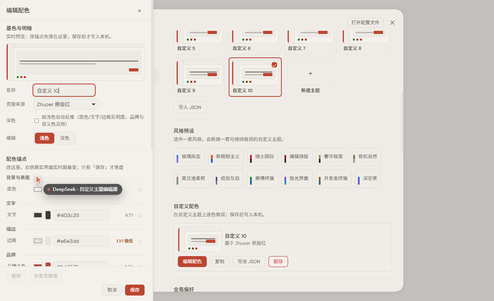
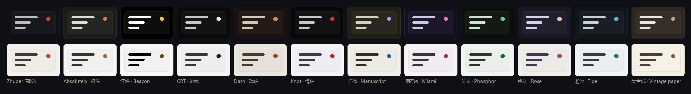
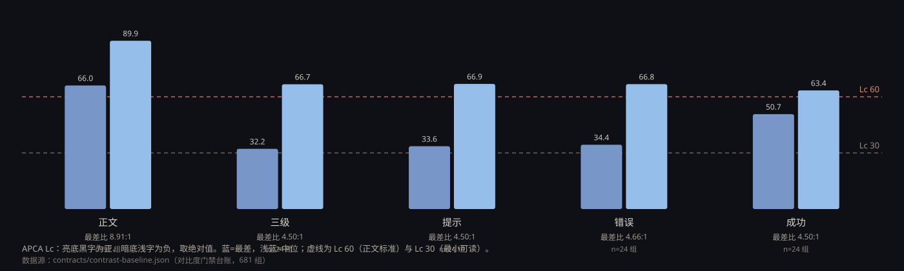
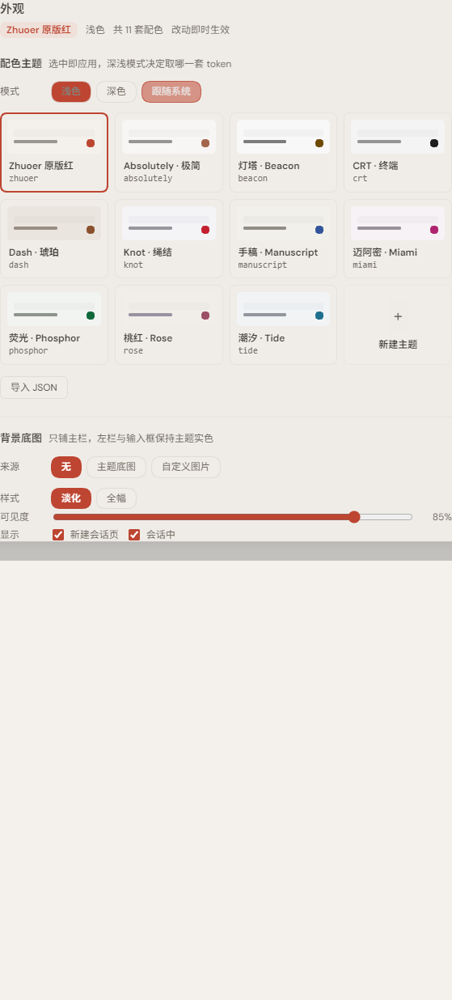
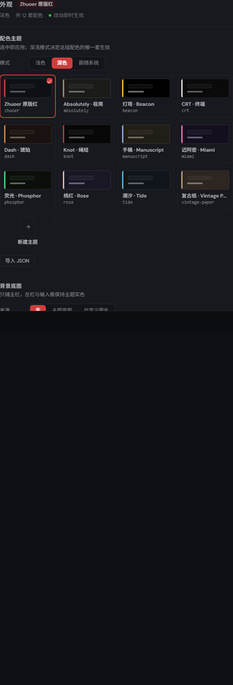

# dsh-zhuoer-theme (Zhu'er Theme)

A skin plugin that recolours the whole DSH UI: **12 built-in themes + 12 style presets + a custom-theme editor (AI generation / image palette extraction / per-anchor tuning)** — and you can generate a whole theme **straight from the chat box**.

> **English** ｜ [中文](README.md)

- Colours go through the host theme service: `ctx.theme.overrideTokens()` maps each theme onto DSH's `--dsw-alias-*` tokens (224 per theme). No DOM hijacking, no injected host components.
- **Fully local**: no account, no telemetry, no external network calls. The only network activity is the host's own model when you press "Generate" in the editor.
- Light / dark / follow-system is **two-way synced** with the host's Settings → Appearance: changing either side updates the other.
- Current version **0.6.42**, MIT.

## At a glance



_A real capture: the drawer only exposes 8 anchors, the right side is the actual host UI re-rendering — not a mockup._



- **12 built-in themes + 12 style presets**, each with its own light and dark set (dark is authored, not derived from light).
- **Contrast is measured**: 679 body/hint/semantic pairs clear 4.5:1 on both backgrounds — reproducible via `npm run coverage`.
- **Theme engineering, not a skin pack**: 8 anchors derive 156 tokens; sample colours from a picture locally, or generate a theme from a chat message.
- **Accessibility**: a consistent focus ring, respect for the system's reduce-motion setting, and an optional 44px minimum hit target.
- **Markdown refinement**: heading size (follow theme / compact / clear levels), code blocks (none / thin border / card), tables (default / bordered / zebra), quotes (default / strong).

## Contrast ledger



Not "probably readable" — every text role has a floor, re-measured by the gate on every theme change:

The chart plots **APCA Lc** (positive on light backgrounds, negative on dark; absolute value shown) — a *secondary* metric next to the WCAG ratio:
a passing ratio does not mean "readable"; on dark surfaces a 4.6:1 pair can sit at Lc 52.
Body text is held to the widely used **Lc ≥ 60** line by the gate; the other roles are recorded but not gated.

| Role | Built-in themes (worst of 24 / median) | Derived floor (custom themes) |
|---|---|---|
| Body | **8.91** / 11.54 | 7:1 |
| Secondary | **4.53** / 6.02 | 6:1 |
| Tertiary | **4.50** / 4.70 | 4.5:1 |
| Error | **4.66** / 5.00 | — |
| Success | **4.50** / 6.54 | — |

> The two columns mean different things: built-in themes are **measured** (hand-tuned, worst secondary 4.53), while the floor only constrains **custom** themes derived from anchors (`enforceTextFloor`: body 7:1, secondary 6:1). The previous version conflated them; corrected.

`npm run verify:contrast` additionally measures preset themes and button foregrounds — **681 pairs** in total, ratchet-only (ledger lives in `contracts/`).

### Three layers: declared / composited / measured

The same text does not have the same real contrast everywhere, so this is done in three layers — **do not merge them**:

| Layer | What it judges | Who does it | Threshold |
|---|---|---|---|
| Declared | the ratio and Lc computed between tokens | `verify:contrast` | hard gate, ratchet-only |
| Composited | worst percentile after the texture is composited onto the base at the real rules (visibility × 0.7, line art via `lighten`) | `verify:texture` | hard gate: erosion over budget is red |
| Measured | the actual ratio between **text pixels and the background under them** in a real screenshot | `scripts/analyze-pixels.mjs` | report only |

The first two are pure computation and live in `verify:all`; the third reads screenshots and cannot (see below).
A concrete case: before 0.6.43 tertiary text sat at 4.60/4.62 against `bg-base` (declared: just passing),
but the real pixels showed it actually rests on the **layer-2 card fill** at 4.25/4.42 — a gap only the third
layer can see. Tertiary is now 4.68/4.61.
## Screenshots

The UI shown is the Chinese one (same components in English; see [README.md](README.md)). Captured from a throwaway profile with an empty config, so no session or workspace data is visible.

| Colour themes · light | Colour themes · dark |
|---|---|
|  |  |


## Features

| Feature | Notes |
|---|---|
| Built-in themes | 12, each with light and dark token sets (224 tokens each) |
| Style presets | 12 (Glassmorphism, Neo-brutalism, Swiss International, Editorial, Luxury minimal, Organic, Morandi, Paper, Cyber terminal, Aurora, Developer terminal, Deep space) — one click fills anchors + radius + fonts |
| Custom themes | Clone a built-in theme and tune only 8 anchor colours; everything else is derived by relative offset. Only anchors are stored, not the full token set |
| AI generation | Turns a style description into anchors using the host's current model; the returned theme name pre-fills the Name field |
| Chat-box generation | Say "give me a cyberpunk palette" in the composer, get a preview card, apply on confirm (the Settings entry stays) |
| Paired light/dark | 8 light and 8 dark anchors are authored **independently** — dark is not derived from light |
| Paired textures | You are asked first; when yes, both a dark and a light texture are produced |
| Spot overrides | Beyond the 8 anchors, up to 4 extra `--dsw-*` keys are allowed |
| Image palette | Picks 6 dominant colours locally and maps them onto anchors; the image is never uploaded |
| Editor drawer | 352px drawer on the left, live UI preview on the right; six sections, sticky header and footer; closing with unsaved edits asks first |
| Theme background | Bind an image to a custom theme, stored in IndexedDB (3 MiB per image); dark and light can each have one, and the image is composited in blend mode (lines only, no base replacement) |
| Photo opacity cap | **Custom photos** (not the built-in line art) are sampled at 64×64 to estimate whether text stays readable underneath, and opacity is automatically capped at the level that keeps 4.5:1 (0.7 at most). At full slider the hint reads "full = 25% opacity (capped for contrast)". Built-in line art is transparent strokes and does not trigger the cap |
| Plugin-page icon | Root `icon.svg` + the `"icon"` field in `package.json`; the Plugins list shows the red Z on a dark tile |
| Settings-section icon | Registered into the `settings.section.icon` slot, so the "Zhuoer 主题" row shows the same red Z (an `icon` field on the registration is ignored — do not use that mechanism) |
| Market icon | `assets/icon-180.png` (180×180, rasterised from `assets/logo/zhuoer.svg`) |
| Brand slot | Replaces the deepseek HARNESS wordmark; off by default. When on it uses the theme's own logo unless you upload an image (downscaled to 512px on the long edge) |
| Text size | Five steps (90 / 100 / 110 / 125 / 140), enlarging **UI copy and message body** (three text paths: `--dsw-font-*` scaling, `--dsh-content-font-*` assignment, and a build-time host-class size table). No geometric zoom is injected — `body{zoom}` breaks the host's sidebar-drag coordinate math and is banned by the gate |
| Transcript width | 920 px by default (the host's own cap), narrowing automatically on small windows; enter 640–1600 to override. Only the host's `--dsh-chat-user-width` is written — no layout geometry is touched. The host's own formula self-measures the column and pins the width near its 680 floor, so this field is the escape hatch |
| Accent colour | Candidate colours per theme plus a free colour picker; button foregrounds are derived to stay readable |
| UI font | Override the UI font family; CJK glyphs fall back to the bundled subsets |
| Right-sidebar quick nav | Three modes: off / show three with hover expansion / show all |
| Import & export | Custom themes and all preferences export to JSON and import back; "Restore default settings" requires two clicks |
| Multilingual | UI copy in **8 languages** (中文 / English / 日本語 / Español / Français / Deutsch / Русский / Português), switching live with the host language; the set matches the host's own list exactly, and the gate fails if one is missing (theme names are intentionally untranslated) |

## Themes

| id | Name | Dark canvas | Accent |
|---|---|---|---|
| zhuoer | Zhuoer 原版红 | `#0e1015` | `#d13c3c` |
| absolutely | Absolutely · 极简 | `#1b1b1a` | `#d97757` |
| beacon | 灯塔 · Beacon | `#000000` | `#ffc233` |
| crt | CRT · 终端 | `#090a09` | `#e8e8e8` |
| dash | Dash · 琥珀 | `#1a1210` | `#cf8b4d` |
| knot | Knot · 绳结 | `#080808` | `#d92a3f` |
| manuscript | 手稿 · Manuscript | `#211e18` | `#8fa8e0` |
| miami | 迈阿密 · Miami | `#140f1e` | `#f472b6` |
| phosphor | 荧光 · Phosphor | `#0a0f0a` | `#4ade80` |
| rose | 桃红 · Rose | `#191724` | `#ebbcba` |
| tide | 潮汐 · Tide | `#10151b` | `#5ab6d8` |

Theme names stay in Chinese on purpose (see "Known limits"): they are part of each theme's identity.

Shape language is also per theme (one `SHAPES` table): brutalist themes are square, terminal themes near-square, paper/manuscript slightly rounded, soft palettes rounder. Shadow scales are defined per theme as well.

## Install

Use DSH's own plugin command. It forwards arguments to pnpm inside the profile **and auto-registers any package that declares `dsh.bundle` as a profile layer** — this plugin does, so all you need afterwards is a restart.

```bash
# From npm (recommended; @latest forces a fresh lookup past pnpm's metadata cache)
dsh plugin --profile <profile> add dsh-zhuoer-theme@latest

# Pin an exact version when you need reproducibility
dsh plugin --profile <profile> add dsh-zhuoer-theme@0.6.17

# From GitHub (pinned to a release tag with provenance)
dsh plugin --profile <profile> add github:zuoyunlai/dsh-zhuoer-theme#v0.6.17
```

Replace `<profile>` with the profile you actually use, e.g. `desktop` or `web` (each is a directory under `~/.dsh/profiles/<profile>`). **Restart DSH** afterwards.

> Why `@latest`: right after a release, cached package metadata can resolve a bare package name to the previous version (observed: installed 0.5.1 right after 0.5.3 shipped). `@latest` forces a fresh resolution; use `@x.y.z` when you want to pin.
>
> **If your default registry is npmmirror**, mirror sync usually lags by minutes to tens of minutes: `@latest` may still resolve an old version. Bypass it explicitly: `dsh plugin --profile <profile> add dsh-zhuoer-theme@latest --registry=https://registry.npmjs.org/`.

> If you see `declares no dsh.bundle — installed as a plain dependency, not a profile layer`, the package did not declare a bundle (not the case here); only then do you need to add the package name to that profile's `dsh.profile.bundles` manually.

> **Asset files require a restart**: the host's plugin asset routes only serve files that existed at boot. New or replaced fonts/backgrounds under `assets/` 404 until you restart (the page still works, the glyphs or image are just missing).
>
> The same applies to code updates (`client.js`): this plugin has no HMR channel.

## Add it to the plugin market (self-hosted index)

DSH **ships no index source** (the official docs are explicit: indexes are third-party content that users add themselves). This repository includes one; this **public URL was verified to work**:

```text
https://ghproxy.net/https://raw.githubusercontent.com/zuoyunlai/dsh-zhuoer-theme/main/market/index.json
```

Usage: **Plugins → Experimental plugins → enable “Custom plugin index” → Discover → Add index source → paste the URL above.** The card then appears in Discover, with title, description, icon, versions and author taken from that index.

**Reachability (measured 2026-11-25, DSH 0.2.2-rc.5)** — DSH fetches the index inside the host process and requires it to return 2xx **without a redirect**:

| URL | Result |
|---|---|
| `ghproxy.net/...` (above) | ✅ 200, no redirect; Discover renders the index title and the card |
| `gh-proxy.com/...` (same format, spare) | ✅ 200, usable as a fallback |
| `raw.githubusercontent.com/...` | ❌ `ECONNRESET` on the Node side (curl working does not imply the host can fetch it) |
| `gitee.com/<owner>/<repo>/raw/...` | ❌ 302 to a signed `raw.giteeusercontent.com` URL; DSH reports `unexpected redirect` |

Fallback: mirror [`market/index.json`](market/index.json) to any static host you can reach (object storage, your own server, a LAN http server; plain HTTP is fine) and add that URL instead.

The index lists only the three safe versions (0.6.42 / 0.6.41 / 0.6.34) and deliberately skips 0.6.11, which shipped a broken settings panel. Run `npm run verify:market` after editing — it checks the official schema (LocalizedText must contain `en`, exact SemVer, `source.type`, `engines.dsh`) and cross-checks it against this package’s `package.json`.

Run `npm run verify:market` after editing — it checks the official schema (LocalizedText must contain `en`, exact SemVer, `source.type`, `engines.dsh`) and cross-checks it against this package’s `package.json`.

## Generate a theme from the chat box

You do not have to open Settings: just describe the style in the composer.

> give me a cyberpunk palette

The assistant first asks one explicit question — **do you want a background texture?** — then:

1. generates **8 light + 8 dark anchors** (the dark set is authored independently, not derived from the light one);
2. when a texture is wanted, generates **two textures** (dark and light — a single dark image looks muddy under a light palette);
3. posts a **preview card** in the chat: swatches, theme name, fonts and radius;
4. applies nothing until you press Apply; Edit lets you tweak anchors first.

Three things worth knowing:

- **Never auto-applied**: the card is a preview, only your confirmation writes it.
- **Colours can come from a picture**: pass a reference image path (`imagePath`) and the anchors are sampled locally from it; the card lists the sampled hex values.
- **At most 4 direct token keys**: the 8 anchors cover 156 tokens; the model may add up to 4 extra `--dsw-*` keys for spot fixes.
- **Textures draw lines, not a new base**: image textures are composited with `mix-blend-mode` (dark `lighten` / light `multiply`), the same technique as the built-in transparent line art.

## Usage

Settings → **Zhuoer 主题**.

- **Colour themes**: 12 built-in cards plus a "New theme" card. Each preview block is painted with that theme's own tokens, so the difference is visible at a glance.
- **Mode**: light / dark / follow system — the same preference as the host's Settings → Appearance, synced both ways.
- **Message text size / accent colour / UI font / right-sidebar quick nav**: apply immediately, no restart.
- **Custom theme cards**: Edit colours / Duplicate / Delete.

## Light–dark sync with the host

The host preference is the single source of truth; the plugin keeps a mirror:

| Direction | Behaviour |
|---|---|
| This page "Mode" → host Appearance | Calls `theme.setTheme('light' \| 'dark' \| 'system')`; the host settings page follows |
| Host Appearance → this page "Mode" | Subscribes to `theme/change`, mirrors `mode` and **recomputes tokens** before notifying the panel (fixed in 0.5.1: it used to re-render without recomputing) |
| Startup | Aligns the local mirror with the host preference, repairing stale local state |

Two things that are easy to confuse:

- `overrideTokens()` itself emits `theme/change`, so the subscriber drops same-value events; otherwise apply → override → apply loops forever (hit in v0.3.3).
- Escape hatch: `localStorage['dsh-zhuoer-theme:mute-sync'] = '1'` disables the subscription entirely. Symptom: "this page → host" works, "host → this page" does not. Check this key first when sync looks broken.

## Custom themes

> Design notes and trade-offs: [docs/ai-theme-plan.md](docs/ai-theme-plan.md). The shipped behaviour is whatever CHANGELOG says.

New themes **clone the currently selected built-in theme** and tune 8 anchors:

| Group | Anchor | Derived |
|---|---|---|
| Background | `--dsw-alias-bg-base` | layer-1/2/3/4, overlay, card, settings-card, skeleton |
| Text | `--dsw-alias-label-primary` | secondary / tertiary / quaternary |
| Border | `--dsw-alias-border-l1` | l2 / l3 / l4 / selected |
| Brand primary | `--dsw-alias-brand-primary` | button fill and hover, brand-text, invert, business, trajectory, onboarding |
| Brand secondary | `--dsw-alias-trajectory-accent` | trajectory and business derivatives |
| Danger | `--dsw-alias-state-error-primary` | label-error, error-secondary |
| Warning | `--dsw-alias-state-warn-primary` | warn-label, warn-secondary |
| Success | `--dsw-alias-state-success-primary` | success-secondary, success-tertiary |

Derivation uses **relative offset**: other tokens in a group shift by their RGB delta from the anchor, so changing the background does not destroy the existing hierarchy.

The editor is a **left** 352px drawer; the right half is fully transparent and click-through — **the real UI is the preview**. Six sections (Appearance / Color anchors / Style presets / AI & color picking / Background image / Shape & fonts), sticky header and footer, and a confirmation before closing with unsaved edits.

- Light and dark are edited separately; switching the editing scheme only affects the preview, not the app preference.
- Every swatch shows live contrast; below 4.5 it warns but does not block saving.
- Only anchors are stored (about 20 hex values per theme), so hundreds of themes still fit in localStorage.
- **AI generation**: describe a style, review the returned name and palette, then press "Apply to current theme" to touch the draft. The name pre-fills unless you already typed one.
- **Image palette**: 6 dominant colours extracted locally; because photos are often bright, applying them switches to the light preview so dark derivation does not hide the effect.

### Theme background images

Source: follow global / theme built-in / custom image / none.

**Images live in IndexedDB** (database `dsh-zhuoer-theme-bg`), not localStorage — 5MB cannot hold several 1920px images and writes fail silently when full. Prefs keep only a reference key (`img_xxxx`); images are preloaded into memory at startup.

- 3 MiB per image
- Deleting a theme removes its image
- JSON export excludes images (binary is not JSON); re-pick them on another machine

## Multilingual (Chinese / English)

All UI copy comes from a shared dictionary in `src/05-i18n.js` (`I18N.zh` / `I18N.en`, 202 keys), read through `t('key', { vars })`:

- The language comes from the host locale service; **anything not `zh*` falls back to English**.
- Changing the language in the host switches the UI live, no reload.
- The panel, editor, JSON modal, error messages, and `aria-label` / `title` / `placeholder` / `alt` all go through the dictionary.
- Theme and preset **names are intentionally not translated** (decision A1, they are part of the identity): the only Chinese left in the English UI should be those names.

To add a string: put it in both dictionaries, call `t('panel.xxx')`, then run `node scripts/verify-text.mjs --update` and `node scripts/verify-keys.mjs`. A bare-Chinese ratchet (`verify:i18n`) only lets the count go down. See [docs/i18n-plan.md](docs/i18n-plan.md).

## Development

### Previewing local changes without switching install mode

A profile plugin has two mutually exclusive install shapes: `link:` (a symlink to your source tree - instant on restart, but **it cannot be updated from the market**) and the registry version (market updates work, source edits do not). `dev:sync` takes a third path - **keep the registry install and push the build output into the installed copy**:

```sh
npm run dev:sync              # build and **preview** the files it would write (writes nothing)
npm run dev:sync -- --apply    # actually copy client.js / index.js / cordis.patch.yml / icon.svg / locale / assets
npm run dev:sync -- --watch    # same, plus watch src/ and build.mjs: save and it rebuilds and copies
```

Default target is `~/.dsh/profiles/desktop/node_modules/dsh-zhuoer-theme`; override with `--profile` or `--dir`. Press the refresh button (dsh-unlag) to swap the client bundle. `index.js` and `cordis.patch.yml` are the server half and need a plugin reload or an app restart.

Client code lives in `src/` as five shards, concatenated in filename order into a single `client.js` by `build.mjs`:

```
src/00-core.js              runtime cost, version constant, diagnostics
src/05-i18n.js              shared dictionary (I18N.zh / I18N.en) + zrT / zrLang / zrSetLang
src/10-themes.js            THEMES/SHAPES/SHADOWS/font table/derivation/host sync
src/20-tokens-and-panel.js  applyTokens, panel and editor, AI and palette
src/30-quicknav.js          right-sidebar quick nav (standalone module)
```

**Edit `src/`, never `client.js`** — the latter is a build artefact; `verify:build` re-concatenates the shards and compares bytes, so hand edits turn it red.

No bundler on purpose: the host merges client plugins into one `/plugins/??a,b,c` request, so `import.meta.url` points at the merged URL and relative imports are unreliable. The runtime must be a single file.

### Single source of truth for theme colours

`themes.mjs` (including each theme's `shadow` field) is the single source of truth; the `const THEMES = {…}` and `const SHADOWS = {…}` inside `client.js` are generated copies:

```sh
npm run sync:themes     # themes.mjs → src/10-themes.js, then build
npm run check:themes    # check only (exit 1 if out of sync)
npm run build           # src/*.js → client.js
```

**Change themes only in `themes.mjs`.** Past incident: fixing only the inlined copy got overwritten by the next sync; `check:themes` now blocks that.

### Adding a built-in theme

1. Add `{ label, light, dark, shadow }` to `THEMES` in `themes.mjs` (both schemes with all 222 tokens).
2. For a dedicated shape language, add an entry to `SHAPES` in `src/10-themes.js` (radii only, no colours).
3. `npm run sync:themes && npm test`.

## Gates and verification

```bash
npm test              # verify:all + headless derivation tests
npm run verify:all    # the gates listed below, in one pass
npm run coverage      # token coverage and the "deliberately not derived" allowlist
```

| Gate | What it checks |
|---|---|
| `verify:build` | `client.js` is byte-identical to re-concatenating `src/` |
| `verify:version` | `PVERSION`, `package.json` and the quoted three-part version string agree (block comments stripped first, so `s5.4.7` inside an SVG path is not mistaken for a version) |
| `verify:contrast` | 12 built-in themes × 2 schemes: body/hint/success and button foregrounds ≥ 4.5:1; the 12 presets are recomputed through the real `buildCustomTokens`; 681-pair ledger, ratchet-only |
| `verify:texture` | **Texture contrast gate**: composites each theme’s texture onto its base at the real rules (visibility × 0.7, line art via `lighten`) pixel by pixel, takes the worst percentile, and flags “passed at base but pushed under 4.5:1 by the texture” plus “erosion over the 0.75 budget”. Swapping a texture or changing a base without re-measuring (sha256 / base mismatch) is red. Compositing lives in `scripts/measure-texture.mjs` (browser canvas — the repo is zero-dep and cannot decode WebP); the gate only re-does the maths from `contracts/texture-luminance.json` |
| `gen:hosttext` | Re-extract the host class → font-size table from `app.asar` (`src/15-host-text.js`). Run once after a host upgrade; skipping it only mismatches some sizes, never breaks interaction |
| `verify:scale` | Font scaling may touch text size only: **`body{zoom}` is banned** (it breaks the host's sidebar-drag hit testing); `--dsw-font-*` px scaling and `--dsh-content-font-*` assignments must both be present |
| `verify:important` | **Priority ratchet**: the `!important` count in client.js must not exceed the baseline (`contracts/important-baseline.json`, currently 77). The host adds one rule, the plugin would add two — this gate stops that arms race from escalating |
| `verify:themes` | Inlined copies equal the source token by token, both schemes complete, contrast met |
| `verify:host` | Host selectors reconciled with the contract, plus two silent-failure checks: contract id fragments still present, plugin icon triple (`icon` / `files` / `exports`) complete |
| `verify:market` | **Market index gate**: validates `market/index.json` against the official schema (LocalizedText must contain `en`, exact SemVer, `source.type`, `engines.dsh`) and cross-checks it with this package’s `package.json` |
| `verify:locale` | **Display metadata gate**: every `locale/*.json` has a non-empty `meta.title`, `en` exists, `exports`/`files` are complete, `./icon` is ≤256 KiB and matches the `icon` field |
| `verify:keys` | **Dictionary gate** (static): every key used by `t('…')` exists in both zh and en, with identical placeholder sets; a missing key or `{n}` vs `{count}` mismatch is red. Covers copy that never renders (drawer, errors, ARIA) |
| `verify:text` | **Copy gate** (deterministic): renders the panel in Node and compares 220 strings and attributes (`title`/`aria-label`/`placeholder`/`alt`) against `contracts/text-snapshot/{zh,en}.json`, versions normalised. Change copy ⇒ run `--update` |
| `verify:visual` | Pixel comparison of the panel (**still out of `verify:all`**): two consecutive captures of the same state differ by 2.3% in light mode, and a gate that cannot reproduce itself is a false sense of safety. Since 0.6.43 it carries **real-device baselines** (`contracts/visual-baseline/`: dark/light 559×2757, narrow 323×666) used for before/after review and for cropping docs images — not an automatic gate |
| `verify:csssnap` | Compares the **injected** CSS text byte for byte against `contracts/css-snapshot/`, reporting the first offset and context. SKIPs when `visual/css-current/` is absent; `--strict` makes it hard-fail |
| `verify:claims` | **Public-claim gate**: theme count, version, background count, string count and the bare-Chinese baseline in README / market index / locale / package.json must equal the freshly computed truth (add a theme, forget the docs → red) |
| `verify:i18n` | Bare-Chinese **ratchet**: per-file baseline that may only go down; new strings must go through the dictionary. Currently 46 |
| `verify:panel` | **Panel smoke test**: loads `client.js` with a minimal host stand-in in Node, calls `apply()` and renders `settings.section` once; any render-time throw is red (this is the gate for the 0.6.11 `t is not defined` class of bug) |
| `verify:git` | Checks `.git` metadata (HEAD/config/index) integrity; `node scripts/git-doctor.mjs --fix` rebuilds it in one command (see `docs/git-integrity.md`) |
| `verify:release` | Release preflight: content-hash comparison of the working tree against HEAD (catches same-length edits swallowed by git's stat cache) plus the version triple |
| `token-surface` | Which host tokens are covered and which are deliberately not derived |
| `node --check` | Artefact syntax |
| `test-derive` | Runs the derivation functions headlessly: 151 keys × 4 bases × 2 schemes |

Theme card previews, AI and palette behaviour are verified in the real UI; gates only cover what is mechanically decidable. **Switch through every theme after changing colours** — see "Known limits".

### Pixels: no comparison gate, but a real measurement

**Pixel comparison** (`verify:visual`) stays out. It was removed from `verify:all` in 0.6.15: same instance,
same state, zero code changes, and two consecutive captures of `.zp-root` differ by **2.301%** in light mode
(61,624 vs 61,130 bytes) while dark is byte-identical; freezing animations, zeroing ancestor scroll offsets and
disabling transitions does not help. A gate that goes red without meaning "broken" and green without meaning
"fine" is a false sense of safety. It is now a **real-device baseline** only: baselines live in
`contracts/visual-baseline/`, you run it by hand before/after a redesign, and `--capture` promotes explicitly.

**Pixel measurement** (`scripts/analyze-pixels.mjs`) is a different thing — a *reading*, not a comparison, so it can run:

- input is a real screenshot; output is the WCAG ratio of every text band plus p5/p50 percentiles;
- it only accepts pixels **lying on the blend line between a `label-*` token and the background** (text can only be an antialiased mix of those); the brand spine, dividers and icons never fall on that line — the first version skipped that step and measured a 3.59:1 spine and a 1.15:1 divider;
- two guards: the band's mode colour must cover ≥40% of the band (in a dense 12px hint line the mode *is* the text colour), and the blend factor t ≥ 0.55 (excludes antialiased edges);
- limits: the theme specimen cards contain **each theme's own miniature UI** (decoration) and are skipped by the guard; gradients/images under text are skipped too.

It is **not in `verify:all`**: thresholds are still human judgement and it needs a real screenshot as input.
Current reading (0.6.43, dark/light/narrow): p5 = 4.53 / 4.57 / 4.68, p50 = 4.62–4.68.

What replaced the pixel comparison remains these deterministic machine checks:

- `verify:text` — rendered panel copy and attributes as zh/en snapshots, item by item;
- `verify:keys` — static key and placeholder parity;
- `verify:csssnap` — injected CSS byte for byte (currently 60,049 B per scheme).

Refresh snapshots after copy changes:

```bash
node scripts/smoke-panel.mjs                       # first, confirm the panel still renders
node scripts/verify-text.mjs --update              # regenerate contracts/text-snapshot/{zh,en}.json
node scripts/verify-css-snapshot.mjs --capture visual/css-current   # only when CSS changed
```

To verify in the real UI (layout or colour changes, or an English pass), follow [docs/live-verify.md](docs/live-verify.md) and boot a throwaway profile: the `desktop` profile is owned by Electron and `dsh web` runs a different profile — neither is a good place to verify this plugin.

## Host contract

`client.js` depends implicitly on things like `[class*="_frame"]` and `[data-windows-titlebar]`. When DSH upgrades, CSS Modules hash suffixes change (we match stable substrings), but the substrings, attribute names and semantics can change too.

`contracts/host-contract.json` records each dependency: **where it is used, what breaks without it.** Reconciliation has only two outcomes:

- `ADDED` — the code added a host selector without registering it; add the semantics.
- `REMOVED` — registered but no longer used; run `--update` after confirming the removal is intentional.

This only covers the **static dependency list**; whether a selector actually matches still has to be checked in the real page (the contract's `breaksIfMissing` is there for exactly that step).

Official hard requirements (package contract + market index schema), this plugin's per-clause evidence, and two pitfalls of the self-check CLI live in [docs/official-requirements.md](docs/official-requirements.md) — walk it before every release.

## Layout

```
README.md            Chinese README (kept in sync)
client.js            build artefact (host entry point, do not edit)
index.js             server half: /api/report, /api/gen-theme, static asset routes
themes.mjs           single source of truth for colours and shadows
src/                 five client shards (incl. 05-i18n.js dictionary)
build.mjs            src → client.js concatenation
scripts/             verify-* gates, sync-themes, coverage, token-surface,
                     analyze-pixels (pixel-level contrast reading), contrast-chart (README chart)
contracts/           host contract lists (positives / negatives), texture-luminance.json,
                     visual-baseline/ (real-device screenshots + labels.json)
visual/              local capture area: current/ screenshots, css-current/ injected CSS
docs/                design notes and runbooks: i18n-plan.md, live-verify.md, official-requirements.md, git-integrity.md
assets/fonts/        23 woff2 files (14 Latin families + 3 CJK subsets) plus provenance
assets/bg/           24 theme backgrounds (webp)
assets/logo/         zhuoer.svg (brand-slot logo, served under /assets/logo/)
assets/icon-180.png  market card icon (180×180, rasterised from zhuoer.svg)
icon.svg             plugin page icon (referenced by package.json "icon")
docs/images/         README screenshots (panel light/dark, 12-theme grid, editor drawer, contrast chart)
locale/{zh,en}.json  display metadata (meta.title / meta.description, read by the host and market)
```

## Release

Releases are tag-triggered in CI; never `npm publish` locally.

**Batch releases: bump the version once, at release time.** While working — code, copy, gates — do **not** touch `package.json` or `PVERSION`; append CHANGELOG entries per batch instead (e.g. 0.6.15 and 0.6.16 were accumulated batches, released together). Bumping for every change produces version numbers that were never published, and users cannot tell which one is current.

1. **At release time** bump once: `package.json` and `PVERSION`, plus a summary entry at the top of CHANGELOG listing the batches it contains.
2. Commit with `npm test` green, then run `npm run verify:release` (content hashes against HEAD), then tag `v<version>` and push.
3. GitHub Actions validates the tag against the version, runs the gates, publishes to npm via OIDC and creates a Release with `slsa.dev/provenance/v1` attestation.
4. **If DSH itself was upgraded before this release**: run `npm run gen:hosttext` first (re-extracts the host font-size table into `src/15-host-text.js`), then `node build.mjs`. Skipping it does not fail any gate; it only leaves some UI text sizes pointing at the previous host's numbers.
5. **Verify the publish with a cache-busting read** — the npm CDN caches the previous version, so a plain read can look like a failed publish:

```bash
curl -s "https://registry.npmjs.org/dsh-zhuoer-theme?t=$(date +%s)" | \
  node -e "let s='';process.stdin.on('data',d=>s+=d).on('end',()=>{const j=JSON.parse(s);console.log(j['dist-tags'].latest, Object.keys(j.versions).slice(-3).join(','))})"
gh release view v<version> -R zuoyunlai/dsh-zhuoer-theme --json isDraft --jq .isDraft
```

   All three must hold: `latest` is the new version, the version list tail contains it, and the Release exists with `draft=false`.

## Known limits

- **AI generation needs a configured host model.** No embedded key, no direct external requests; a missing model is an explicit error, never a silent fallback to random colours.
- **No unicode-range splitting for CJK fonts.** The three CJK faces are already ~4,400-glyph subsets; splitting by frequency saves only 11–12% while inlining ~22k characters of disjoint ranges and turning "download once" into "maybe twice". The real first-paint cost is not putting a serif CJK face on the default path — already the case.
- **Shadow scales**: `themes.mjs` `--dsw-elevation-*` and the plugin's own `shadow` are two different scales (the latter scales with light/dark). Merging them needs a new visual scale, which is data design rather than cleanup.
- **Colours and shapes need human eyes**: gates prove contrast and completeness, not that a radius looks good on your display.
- **The texture gate only judges erosion**: built-in line art measures p50 = 0 (transparent strokes, slightly lighter than the base), so it is not a defect source; the gate flags "passing at base but pushed under 4.5:1" and "erosion over 10%", and does not endorse a theme's design choices.
- **The photo cap is an estimate, not a guarantee**: 64×64 sampling plus an alpha sweep reliably stops obviously unreadable cases (a white photo on a dark base), but large low-frequency areas (faces, sky) can sample optimistically; it guarantees a floor, not per-pixel optimality.
- **The pixel reading depends on the capture**: `analyze-pixels` reads one real render; a different DSH version, theme or zoom changes it. It reports "measured at that moment", never a permanent contract.
- **DSH upgrades can break the contract**: class substrings and attribute names are not public API; `verify:host` tells you what the code uses, not whether it still matches.
- **Settings-section icon goes through a slot**: an `icon` field on the `settings.section` registration is ignored (dropped since 0.6.2, falls back to a gear). Register into `settings.section.icon` with `id` equal to the section id; the host calls it with `{ size, active }` (red Z shipped in 0.6.6). The three mechanisms — `package.json` `icon`, slot contribution, registration field — are unrelated; evidence lives in `contracts/host-contract.json` `positives` / `negatives`.
- **Theme and preset names are not translated** (decision A1): they are part of each theme's identity. Group labels, buttons, notes and error messages all are.

## Privacy

Endpoint trust boundary, on-disk artefacts and diagnostic switches: see [SECURITY.md](SECURITY.md).

- Preferences (theme id, mode mirror, font size, accent colour, background reference keys) live in local `localStorage`; backgrounds live in IndexedDB.
- Diagnostic logging is **off** by default. To reproduce an issue, run `localStorage['dsh-zhuoer-theme:debug'] = '1'` in the console and reload; logs go to the plugin data directory. Remove the key afterwards.
- The only action that sends your description anywhere is "Generate", which goes through the host model service — the same channel as normal chat.

## Licence

- Code: MIT (see [LICENSE](LICENSE)).
- Theme colours: derived from Zhuoer (MIT), remapped onto DSH tokens.
- Bundled fonts: all SIL Open Font License 1.1; provenance and subsetting in [assets/fonts/README.md](assets/fonts/README.md).
