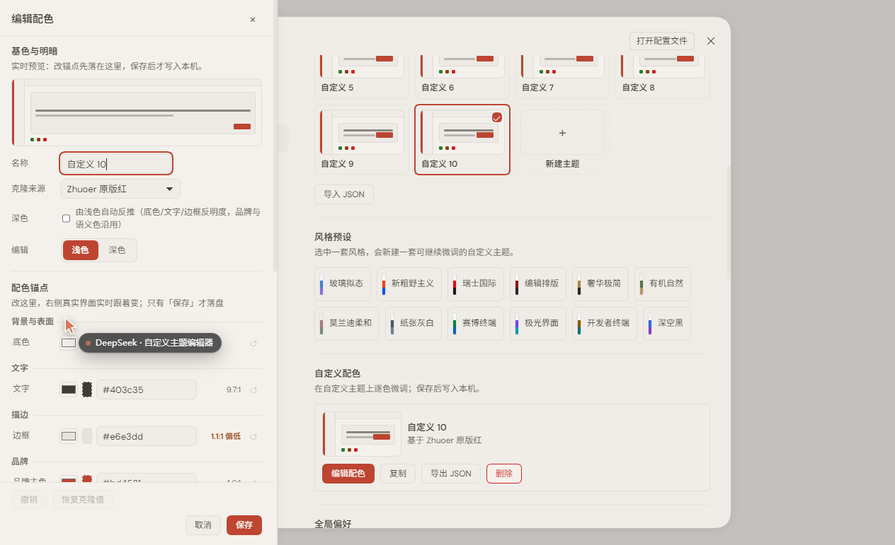
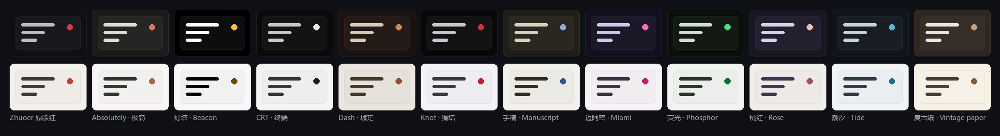
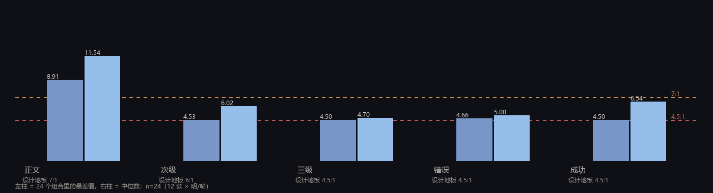
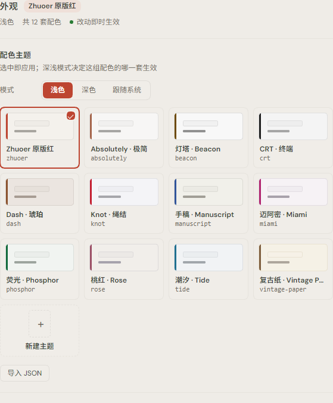
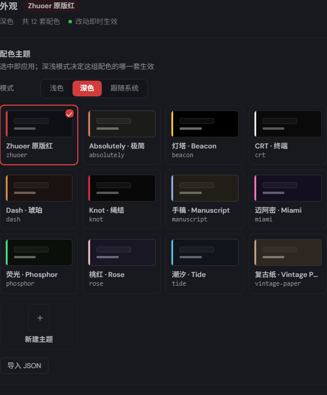

# dsh-zhuoer-theme（卓尔主题）

> **中文** ｜ [English](README.en.md)

给 DSH 换整套配色的皮肤插件：**12 套内置主题 + 12 套风格预设 + 自定义主题编辑器（AI 生成 / 图片取色 / 逐色微调）**，还能**直接在对话框里用一句话生成整套主题**。

- 配色走宿主主题服务：`ctx.theme.overrideTokens()` 把每套主题映射到 DSH 的 `--dsw-alias-*` token（每套 224 个），不劫持 DOM 结构、不注入宿主组件。
- **纯本地**：没有账号、没有遥测、不请求外部网络。唯一的联网行为是你在编辑器里点「AI 生成」时，插件通过**宿主自己的模型**补一组锚点色。
- 明暗三态（浅色 / 深色 / 跟随系统）与宿主「通用设置 → 外观」**双向同步**，两边改任一边都会一起变。
- 当前版本 **0.6.28**，MIT。

## 一眼看清



_真机截图：左侧抽屉只放 8 组锚点，右侧是宿主真实界面在跟着变——不是效果图。_



- **12 套内置 + 12 套风格预设**，每套都出明/暗两档（深色不是由浅色反算）。
- **对比度有台账**：679 组正文/提示/语义色在两档底色上 ≥ 4.5:1，`npm run coverage` 可复核。
- **主题工程，不是皮肤包**：8 组锚点派生 156 个 token；能按图本地取色、能在对话框里一句话生成。

## 对比度台账



不是「大概看得清」，是每个文字角色都有地板，并且每次改主题都会被门禁重新量一遍：

| 角色 | 内置主题实测（24 组合最差 / 中位） | 自定义主题派生地板 |
|---|---|---|
| 正文 | **8.91** / 11.54 | 7:1 |
| 次级 | **4.53** / 6.02 | 6:1 |
| 三级 | **4.50** / 4.70 | 4.5:1 |
| 错误 | **4.66** / 5.00 | — |
| 成功 | **4.50** / 6.54 | — |

> 两列含义不同：**内置主题是「实测」**（设计师定的，各不相同，次级最差 4.53）；**派生地板**只约束自定义主题（改锚点时由 `enforceTextFloor` 兜住，正文 7:1、次级 6:1）。上一版这里把两列混写了，已更正。

`npm run verify:contrast` 还会额外量预设主题与按钮前景色，合计 679 组，只升不降（台账在 `contracts/` 里）。
## 截图

界面默认中文（英文界面同一套组件，见 [README.en.md](README.en.md)）。图片取自空配置的一次性 profile，没有会话、工作区等个人信息。

| 配色主题 · 浅色 | 配色主题 · 深色 |
|---|---|
|  |  |


## 功能一览

| 能力 | 说明 |
|---|---|
| 内置主题 | 12 套，每套含明/暗两档，各 224 个 token |
| 风格预设 | 12 套（玻璃拟态、新粗野主义、瑞士国际、编辑排版、奢华极简、有机自然、莫兰迪柔和、纸张灰白、赛博终端、极光界面、开发者终端、深空黑），一键填齐锚点 + 圆角 + 字体 |
| 自定义主题 | 克隆当前内置主题，只调 8 组锚点色，其余按相对偏移派生；存的是锚点不是全量 token。上限 24 套，满了要先删：删除需点两次确认（连底图一起清，不可撤销） |
| AI 生成 | 用宿主当前模型把一句风格描述转成锚点；**返回主题名并自动预填「名称」框**（0.5.2） |
| 对话框生成 | 在聊天框里说「给我一套赛博朋克配色」，出预览卡片，确认后应用（设置页里的 AI 生成仍然保留） |
| 明暗各自成对 | 浅色与深色各 8 组锚点**独立生成**，深色不由浅色推算 |
| 底纹成对 | 生成前先问要不要底纹；要就同时出深色/浅色两张 |
| 少量覆盖 | 除 8 组锚点，模型最多再给 4 个 `--dsw-*` 键做点对点修正 |
| 图片取色 | 选一张图本地提 6 个主色填入锚点，图片不上传 |
| 编辑配色页 | 左侧 352px 抽屉 + 右侧真实界面实时预览；分六段，头尾吸顶吸底；未保存改动关闭会先确认 |
| 主题底图 | 可给每个自定义主题绑一张图，存 IndexedDB（单张上限 3 MiB）；深色/浅色可各绑一张，图像以混合模式叠加（只留线条，不替换底色） |
| 插件页图标 | 根目录 `icon.svg` + `package.json` 的 `"icon"`；设置 → 插件 列表里显示深灰底红 Z（与市场卡片同源） |
| 设置页图标 | 向 `settings.section.icon` 槽注册贡献，设置页左侧「Zhuoer 主题」那一行显示同一枚红 Z（`register()` 上的 `icon` 字段无效，别用错机制） |
| 市场图标 | `assets/icon-180.png`（180×180，由 `assets/logo/zhuoer.svg` 栅格化），用于插件市场卡片 |
| 品牌位 | 替换左上角 deepseek HARNESS 徽标；默认关闭。开启后默认用主题自带 logo（红色 Z 方形标），上传图片则覆盖它（压到最长边 512px） |
| 字号 | 90 / 100 / 110 / 125 / 140 五档，**放大界面文字与对话正文**（三条文字通路：`--dsw-font-*` 换算、`--dsh-content-font-*` 赋值、构建期抽出的宿主类名表）。不注入任何几何缩放——`body{zoom}` 会让宿主侧栏拖拽的坐标对账失效（实测「点不中把手、拖的却是中栏」），该写法已被门禁禁止 |
| 对话宽度 | 默认 920px（宿主的宽度上限），窗口放不下时按视口自动收窄；填 640–1600 覆盖它。只写宿主的 `--dsh-chat-user-width`，不改任何布局尺寸；宿主自己那套「按中栏宽度自我测量」的公式会把正文锁在 680 下限附近，这个输入框就是绕开它的入口 |
| 强调色 | 每套主题给一组候选色，也可自由取色；写入后会派生按钮前景色保证可读 |
| 界面字体 | 可覆盖 UI 字体族；中文字形由随包子集兜底 |
| 右侧快捷导航 | 三个档位：关闭 / 只露三个（悬停展开）/ 全部常驻 |
| 导入导出 | 自定义主题与全部偏好可导出 JSON、导入还原；「恢复默认设置」需两步确认 |
| 多语言 | 界面文案中英双语，跟随宿主语言**实时**切换；非中文语言回落英文（主题名按设计不译） |

## 主题清单

| id | 名称 | 深色画布 | 强调色 |
|---|---|---|---|
| zhuoer | Zhuoer 原版红 | `#0e1015` | `#d13c3c` |
| absolutely | Absolutely · 极简 | `#1b1b1a` | `#d97757` |
| beacon | 灯塔 · Beacon | `#000000` | `#ffc233` |
| crt | CRT · 终端 | `#090a09` | `#e8e8e8` |
| dash | Dash · 琥珀 | `#1a1210` | `#cf8b4d` |
| knot | Knot · 绳结 | `#080808` | `#d92a3f` |
| manuscript | 手稿 · Manuscript | `#211e18` | `#8fa8e0` |
| miami | 迈阿密 · Miami | `#140f1e` | `#f472b6` |
| phosphor | 荧光 · Phosphor | `#0a0f0a` | `#4ade80` |
| rose | 桃红 · Rose | `#191724` | `#ebbcba` |
| tide | 潮汐 · Tide | `#10151b` | `#5ab6d8` |

形状语言也按主题身份分档（同一套 `SHAPES` 表）：brutal 系全直角、终端系小直角、纸张/手稿系小圆角、软色系大圆角；阴影刻度同样逐主题定义。

## 安装

用 DSH 自带的插件管理命令。它把参数转发给 profile 目录里的 pnpm，**并对声明了 `dsh.bundle` 的包自动登记成 profile 图层**——本插件声明了，所以装完只需要重启。

```bash
# 从 npm 安装（推荐；@latest 会强制查最新，绕开发版后 pnpm 的元数据缓存）
dsh plugin --profile <profile> add dsh-zhuoer-theme@latest

# 需要可复现的固定版本时（把 x.y.z 换成你要的版本）
dsh plugin --profile <profile> add dsh-zhuoer-theme@0.6.17

# 从 GitHub 安装（锁定带 provenance 的发布 tag）
dsh plugin --profile <profile> add github:zuoyunlai/dsh-zhuoer-theme#v0.6.17
```

`<profile>` 换成你在用的那个，例如 `desktop` 或 `web`（对应 `~/.dsh/profiles/<profile>`）。装完**重启 DSH** 生效。

> 为什么推荐 `@latest`：刚发布后的一小段时间里，包元数据缓存可能把「裸包名」解析成上一版（0.5.3 发布后实测装到 0.5.1）。写 `@latest` 会强制按最新解析；要锁定版本则写 `@x.y.z`。
>
> **如果你的默认 registry 是 npmmirror（淘宝镜像），镜像同步通常滞后几分钟到几十分钟**：此时 `@latest` 拿到的可能仍是旧版。实测 0.5.6 发布后，npmjs 已是 `latest=0.5.6`，npmmirror 仍显示 0.5.5。绕过办法是显式指定 registry：`dsh plugin --profile <profile> add dsh-zhuoer-theme@latest --registry=https://registry.npmjs.org/`。

> 如果输出 `declares no dsh.bundle — installed as a plain dependency, not a profile layer`，说明该包没声明 bundle（不是本插件的情况）；此时才需要手动把包名补进该 profile `package.json` 的 `dsh.profile.bundles`。
>
> 喜欢手工管理也可以：在 profile 的 `package.json` 加依赖 → `pnpm install` → 把包名加进 `dsh.profile.bundles` → 重启。命令只是把这几步合并了。

> **资源文件必须重启才可见**：宿主的插件资源路由只服务启动时已存在的文件。新增/替换 `assets/` 下的字体或底图后，对应 URL 会 404（页面本身正常，只是字或底图缺失），重启即可。
>
> 同理，更新插件代码（`client.js`）后也需要重启 DSH；本插件没有 HMR 通道。

## 添加到插件市场（自建索引源）

DSH **不内置任何索引源**（官方文档：索引是第三方内容，由用户自己添加）。本仓自带一份索引文件，**实测可用的公共 URL**：

```text
https://ghproxy.net/https://raw.githubusercontent.com/zuoyunlai/dsh-zhuoer-theme/main/market/index.json
```

用法：**插件 → 实验性插件 → 打开「自定义插件索引」→「发现」→「添加索引源」→ 粘贴上面的 URL**。完成后「发现」里会出现本插件卡片（标题、说明、图标、版本、作者都来自这份索引）。

**可达性实测（2026-11-25，DSH 0.2.2-rc.5）**——DSH 在宿主进程里 fetch 索引，且要求它**不经重定向**返回 2xx：

| URL | 结果 |
|---|---|
| `ghproxy.net/...`（上面那条） | ✅ 200、无重定向，「发现」正常显示索引标题与卡片 |
| `gh-proxy.com/https://raw.githubusercontent.com/zuoyunlai/dsh-zhuoer-theme/main/market/index.json`（同格式备用） | ✅ 200，可作备用 |
| `raw.githubusercontent.com/...` | ❌ Node 侧 `ECONNRESET`（curl 能通不代表宿主能通） |
| `gitee.com/<owner>/<repo>/raw/...` | ❌ 302 跳到带签名的 `raw.giteeusercontent.com`，DSH 报 `unexpected redirect` |

兜底：把 [`market/index.json`](market/index.json) 镜像到你能访问的静态主机（对象存储 / 自己的服务器 / 内网 http；HTTP 即可，不要求 https），再添加那个 URL。

索引只列 **0.6.28 / 0.6.27 / 0.6.26** 三个可安全使用的版本（刻意跳过 0.6.11 那版面板报错的）。改完跑 `npm run verify:market`——它按官方 schema 校验 LocalizedText 必含 `en`、SemVer、`source.type`、`engines.dsh`，并与 `package.json` 交叉对账。


## 在对话框里生成主题

不用打开设置页：在聊天框里说一句风格描述即可。

> 给我一套赛博朋克配色

助手会先问你**要不要底纹**（一次，明确提问），然后：

1. 生成**浅色 8 组 + 深色 8 组**锚点——深色不是由浅色推算，而是独立给一套；
2. 要底纹时同时生成**深色、浅色两张**底图（一张深图放在浅色主题下会发闷）；
3. 在对话里出一张**预览卡**：色卡、主题名、字体与圆角；
4. 你点「应用」才写入并立刻生效；点「修改」可改锚点后再应用。

三点要知道：

- **绝不自动应用**：卡片只是预览，只有你点确认才落地。
- **可以按图配色**：把参考图路径传给工具（`imagePath`），锚点由图片**本地真实采样**得出，卡片会列出取到的色值。
- **最多 4 个直写键**：8 组锚点覆盖 156 个 token，模型还能额外给不超过 4 个 `--dsw-*` 键做点对点修正。
- **底纹只画线、不换底**：图像底纹以 `mix-blend-mode` 叠加（深色 `lighten` / 浅色 `multiply`），与内置主题的「透明线稿」同一种画法。

## 使用

设置 → **Zhuoer 主题**。

- **配色主题**：12 套内置卡 + 「新建主题」卡。卡片上的预览块用该主题自己的 token 上色，所以能直接看出差别。
- **模式**：浅色 / 深色 / 跟随系统。它与宿主「通用设置 → 外观」是同一个 preference，两边任改一边都会同步。
- **正文字号 / 强调色 / 界面字体 / 右侧快捷导航**：即时生效，不需要重启。
- **自定义主题卡**：编辑配色 / 复制 / 删除。

## 明暗三态与宿主同步

宿主 preference 是唯一真源，插件本地只存一份镜像：

| 改动方向 | 行为 |
|---|---|
| 本页「模式」→ 宿主外观 | 调 `theme.setTheme('light' \| 'dark' \| 'system')`，宿主设置页跟着变 |
| 宿主外观 → 本页「模式」 | 订阅 `theme/change`，镜像 `mode` 后**重算 token** 再通知面板（0.5.1 修复：以前只重渲染不重算，表现为「数字变了、画面没变」） |
| 启动时 | 用宿主 preference 对齐本地镜像，纠正历史存档里两端不一致的情况 |

两个容易混淆的点：

- `overrideTokens()` 自己也会 emit `theme/change`，所以订阅端对「同值事件」直接丢弃，否则会形成 apply → override → apply 的同步死循环（v0.3.3 踩过）。
- 逃生阀：`localStorage['dsh-zhuoer-theme:mute-sync'] = '1'` 会**完全关闭**这条订阅。表现是「本页 → 宿主」正常、「宿主 → 本页」失效；怀疑同步坏了先查这个键。

## 自定义主题

> 实现前的设计与权衡记录见 [docs/ai-theme-plan.md](docs/ai-theme-plan.md)（文档保留设计推演，落地版本以 CHANGELOG 为准）。

新建时**克隆当前选中的内置主题**，只调 8 组锚点：

| 组 | 锚点 | 自动派生 |
|---|---|---|
| 底色 | `--dsw-alias-bg-base` | layer-1/2/3/4、overlay、card、settings-card、skeleton |
| 文字 | `--dsw-alias-label-primary` | secondary / tertiary / quaternary |
| 边框 | `--dsw-alias-border-l1` | l2 / l3 / l4 / selected |
| 品牌主色 | `--dsw-alias-brand-primary` | 按钮填充与 hover、brand-text、invert、business、trajectory、onboarding |
| 品牌次色 | `--dsw-alias-trajectory-accent` | trajectory、business 的衍生色 |
| 危险 | `--dsw-alias-state-error-primary` | label-error、error-secondary |
| 警告 | `--dsw-alias-state-warn-primary` | warn-label、warn-secondary |
| 成功 | `--dsw-alias-state-success-primary` | success-secondary、success-tertiary |

派生用**相对偏移**：组内其它 token 按它们与锚点的 RGB 差值整体平移，换底色不会破坏原有层次关系。

编辑器是**左侧** 352px 抽屉，右半区完全透明、点击穿透 —— **真实界面就是预览**。抽屉分六段（外观 / 配色锚点 / 风格预设 / AI 与取色 / 底图 / 形状与字体），头尾吸顶吸底；有未保存改动时关闭会先确认。要点：

- 明暗分开编辑；编辑器里切「编辑深/浅」只影响预览，不改应用自身的明暗偏好。
- 每个色板实时显示对比度，低于 4.5 标黄提示，但不阻止保存。
- 只存锚点（每套约 20 个 hex），几百套也不会撑爆 localStorage。
- **AI 生成**：输入一句风格描述，结果先显示主题名与色板，点「填入当前主题」才落到草稿；名称会自动预填（你已手输则不会覆盖）。
- **图片取色**：本地提 6 个主色；照片原色常常偏亮，填入后会切到浅色预览，避免被深色反推掩盖。

### 主题自带底图

来源四档：跟随全局 / 主题自带 / 自定义图片 / 无。

**图片存在 IndexedDB**（库名 `dsh-zhuoer-theme-bg`），不是 localStorage —— 后者 5MB 装不下多张 1920px 图，且写满时是**静默失败**。pref 里只留引用键（`img_xxxx`），启动时预加载进内存供同步取用。

- 单张上限 3 MiB
- 删主题会自动清掉它绑的图
- 导出 JSON 不含底图（二进制不进 JSON），换机器需重新选图

## 多语言（中文 / English）

界面文案走一份共享词典 `src/05-i18n.js`（`I18N.zh` / `I18N.en`，当前 202 条），取词统一用 `t('键', { 占位 })`：

- 语言来源是宿主 locale 服务；**非 `zh*` 一律回落英文**（面向国际用户）；
- 宿主里改语言会实时切换，不需要刷新页面；
- 面板、编辑器、JSON 浮层、错误提示、`aria-label` / `title` / `placeholder` / `alt` 全部走词典；
- 主题名与风格预设名**不译**（决策 A1，品牌标识）：英文界面里剩下的中文应当只有这些名字。

新增文案的做法：把字符串写进 `05-i18n.js` 的两套词典 → 代码里改成 `t('panel.xxx')` → 跑
`node scripts/verify-text.mjs --update`（渲染得到的文案）与 `node scripts/verify-keys.mjs`（键与占位符）。
裸中文有棘轮门 `verify:i18n` 兜底：只许减少，多一条就红。规划与进度见 [docs/i18n-plan.md](docs/i18n-plan.md)。

## 开发

### 开发预览（不切换安装方式）

profile 里的插件有两种安装形态，互斥：`link:`（符号链接到源码目录，改完重启即生效，但**无法从市场更新**）与 registry 版本（能从市场更新，但改源码不生效）。`dev:sync` 走第三条路——**保持 registry 安装，把构建产物推进已安装目录**：

```sh
npm run dev:sync              # 构建并**预览**将要写入的文件（默认不写）
npm run dev:sync -- --apply    # 真写：复制 client.js / index.js / cordis.patch.yml / icon.svg / locale / assets
npm run dev:sync -- --watch    # 同上，且监听 src/ 与 build.mjs，保存即构建并复制
```

目标目录默认 `~/.dsh/profiles/desktop/node_modules/dsh-zhuoer-theme`，可用 `--profile` / `--dir` 覆盖。复制完按一次刷新按钮（dsh-unlag）即换掉客户端代码；`index.js` 与 `cordis.patch.yml` 属于服务端一半，需要插件重载或重启 App 才生效。

客户端代码在 `src/` 下分五片，由 `build.mjs` 按文件名顺序拼成单文件 `client.js`：

```
src/00-core.js              运行时开销、版本常量、诊断
src/05-i18n.js              共享词典（I18N.zh / I18N.en）+ zrT / zrLang / zrSetLang
src/10-themes.js            THEMES/SHAPES/SHADOWS/字体表/派生纯函数/宿主同步
src/20-tokens-and-panel.js  applyTokens、面板与编辑器、AI 与取色
src/30-quicknav.js          右侧快捷导航（独立模块）
```

**改代码请改 `src/`，不要直接改 `client.js`** —— 它是构建产物，`verify:build` 会拿分片重新拼接做字节比对，直接改产物会红。

不引入打包器是刻意的：客户端插件会被宿主合并进 `/plugins/??a,b,c` 的打包请求，`import.meta.url` 指向合并 URL，相对 import 不可靠，所以运行时必须是单文件。

### 主题色的唯一真源

主题色的唯一真源是 `themes.mjs`（含每套主题的 `shadow` 字段）。`client.js` 里的 `const THEMES = {…}` 与 `const SHADOWS = {…}` 都是它生成的副本：

```sh
npm run sync:themes     # themes.mjs → src/10-themes.js，然后自动 build
npm run check:themes    # 只检查是否需要同步（不一致时退出码 1）
npm run build           # src/*.js → client.js
```

**改主题只改 `themes.mjs`**。曾经踩过：只改内联副本、没改真源，下一次 sync 会把修复原样覆盖回去；现在 `check:themes` 会拦住。

### 加一套内置主题

1. 在 `themes.mjs` 的 `THEMES` 里加一组 `{ label, light, dark, shadow }`（两档都要齐 224 个 token）。
2. 如需专属形状语言，在 `src/10-themes.js` 的 `SHAPES` 加条目（只放 `--dsw-radius-*` 之类，不要放配色）。
3. `npm run sync:themes && npm test`。

## 门禁与验证

```bash
npm test              # verify:all + 派生纯函数无头测试
npm run verify:all    # 下列门禁一次跑完
npm run coverage      # token 覆盖率与「刻意不跟锚点」的豁免清单
```

| 门 | 检查什么 |
|---|---|
| `verify:build` | `client.js` 与 `src/` 分片重新拼接的结果逐字节相等 |
| `verify:version` | `PVERSION`、`package.json`、带引号的三段式版本字符串一致（先剥块注释，避免把 SVG path 里的 `s5.4.7` 当版本号） |
| `verify:contrast` | 内置 12 套 × 两态的正文/提示/success/错误色 × 两档底与按钮前景色 ≥ 4.5:1，另含设置面板文字面；12 套预设走真实 `buildCustomTokens` 复算；台账 679 组只升不降 |
| `gen:hosttext` | 从 `app.asar` 重抽宿主类名 → 字号表（`src/15-host-text.js`）。宿主升级后跑一次；不跑只是部分字号对不上，不会坏交互 |
| `verify:scale` | 字号缩放只许动文字尺寸：**禁止 `body{zoom}`**（会让宿主侧栏拖拽命中错位），要求 `--dsw-font-*` 的 px 缩放与 `--dsh-content-font-*` 赋值同时存在 |
| `verify:important` | **优先级棘轮门**：client.js 里的 `!important` 数量不得高于基线（`contracts/important-baseline.json`，当前 78）。宿主加一条、插件就得加两条——这条门让军备竞赛不再升级 |
| `verify:themes` | 内联副本与真源逐 token 相等、两档 token 集合齐全、对比度达标 |
| `verify:host` | 宿主选择器与契约对账，另查两类「静默失效」：契约登记的 id 片段是否还在代码里、`package.json` 的插件图标三件套（`icon` / `files` / `exports`）是否齐全 |
| `verify:market` | **市场索引门**：按官方 schema 校验 `market/index.json`（LocalizedText 必含 `en`、精确 SemVer、`source.type`、`engines.dsh`），并与本仓 `package.json` 交叉对账 |
| `verify:locale` | **展示元数据门**：`locale/*.json` 的 `meta.title` 非空、`en` 必存、`exports`/`files` 齐全、`./icon` ≤256 KiB 且与 `icon` 字段指向一致 |
| `verify:keys` | **词典门**（静态）：源码里 `t('…')` 用到的键必须在 zh/en 都存在，且同名键占位符集合一致；缺键或 `{n}`/`{count}` 不一致即红。审的是「渲染不到」的文案（抽屉、错误、ARIA） |
| `verify:text` | **文案门**（确定性）：Node 端渲染面板，把 155 条文案与属性（`title`/`aria-label`/`placeholder`/`alt`）与 `contracts/text-snapshot/{zh,en}.json` 逐条比对，版本号归一化。改文案要配 `--update`，否则红 |
| `verify:visual` | 面板截图像素比对（**已从 `verify:all` 摘除**）：同状态连续两次截 `.zp-root` 在光态下互差 2.3%，无法复现的像素门等于安全错觉。脚本保留，需要人工看图时再跑 |
| `verify:csssnap` | 把插件**实际注入**的 CSS 文本与 `contracts/css-snapshot/` 逐字节比对；差异会报出首个偏移与上下文。没有 `visual/css-current/` 时 SKIP，`--strict` 才硬判 |
| `verify:claims` | **对外口径门**：README / market 索引 / locale / package.json 里的主题数、版本号、底图数、文案条数、裸中文基线必须等于现算真值（加主题后忘记改文档 → 红） |
| `verify:i18n` | 裸中文字面量**棘轮**：按文件记基线，只许减少；多一条就红（文案要写进 `src/05-i18n.js` 的 `I18N` 再 `t()` 取）。当前合计 46 条 |
| `verify:panel` | **面板冒烟**：Node 端用最小宿主替身加载 `client.js`、调 `apply()`，把 `settings.section` 真渲染一遍；任何渲染期抛错即红（0.6.11 的 `t is not defined` 就是它该抓的） |
| `verify:git` | `.git` 元数据（`HEAD`/`config`/`index`）是否完好；损坏时 `node scripts/git-doctor.mjs --fix` 一键重建（见 `docs/git-integrity.md`） |
| `verify:release` | 发版预检：按内容哈希比对工作区与 HEAD（抓「同长度编辑被 git stat 缓存吞掉」），并校验版本三元组 |
| `token-surface` | 覆盖了哪些宿主 token、哪些是刻意不跟锚点的 |
| `node --check` | 产物语法 |
| `test-derive` | 从 `#region derive` 抠出派生函数无头跑：151 键 × 4 基色 × 2 态 |

主题卡预览、AI 与取色逻辑都在真实界面里验；门禁只保证「可机械判定」的那部分。**改完配色请自己切一圈主题**，见「已知边界」。

### 为什么没有像素基线了

0.6.15 起，「面板截图逐像素比对」被**撤出 `verify:all`**。原因不是懒得维护，而是它无法自我复现：
在同一个实例、同一个状态、零代码改动的前提下连续截两次 `.zp-root`，**光态互差 2.301%**
（61,624 vs 61,130 字节），暗态却逐字节相同；冻结动画（`transition:none;animation:none`）、
把祖先滚动条归零之后依旧不复现。一个红了说明不了代码坏、绿了也说明不了代码好的门，
给的是安全错觉。脚本保留（`scripts/verify-visual.mjs`），需要人眼看图时再手动跑。

替代它的是两条**确定性**的机器判据：

- `verify:text` —— 面板渲染出的文案与属性存成 zh/en 快照，逐条比对（版本号归一化）；
- `verify:keys` —— 静态校验 `t('…')` 的键两侧齐全、占位符集合一致；
- 样式仍由 `verify:csssnap` 逐字节把关（当前两态各 60,049 B）。

改文案后刷新快照：

```bash
node scripts/smoke-panel.mjs                       # 先确认面板还能渲染
node scripts/verify-text.mjs --update              # 重新生成 contracts/text-snapshot/{zh,en}.json
node scripts/verify-css-snapshot.mjs --capture visual/css-current   # 改过 CSS 才需要
```

要在真实界面上验证（改了布局、颜色、或要复检英文界面），按 [docs/live-verify.md](docs/live-verify.md)
用一次性 profile 起一个可访问的宿主实例——桌面端 profile 由 Electron 独占，`dsh web` 用的是另一个 profile，
两者都不适合直接验证本插件。

## 宿主契约

`client.js` 里有大量 `[class*="_frame"]`、`[data-windows-titlebar]` 这类对 DSH 的隐式依赖。DSH 升级时 CSS Modules 的 hash 后缀会变（我们用稳定子串规避），但子串本身、属性名与语义都可能改。

`contracts/host-contract.json` 登记每一项：**用在哪、失效会怎样**。对账只有两种结果：

- `ADDED` —— 代码新加了宿主选择器却没登记，必须补语义
- `REMOVED` —— 契约里有、代码已不用，确认有意删除后跑 `--update`

这套只覆盖**静态依赖清单**；某个选择器是否真能命中，仍需在真实页面上验一次（契约里的 `breaksIfMissing` 就是给那一步看的）。

官方对插件的硬要求（包契约 + 市场索引 schema）、本插件的逐条合规证据、以及自检工具的两个坑，
统一记在 [docs/official-requirements.md](docs/official-requirements.md) —— 发版前照着勾一遍。

## 目录结构

```
README.en.md         English README（与中文版同步维护）
client.js            构建产物（宿主加载入口，勿手改）
index.js             服务端一半：/api/report、/api/gen-theme、静态资源路由
themes.mjs           主题色 + 阴影的唯一真源
src/                 客户端源码五分片（00-core / 05-i18n / 10-themes / 20-panel / 30-quicknav）
build.mjs            src → client.js 拼接
scripts/             verify-* 门禁、sync-themes、coverage、token-surface
contracts/           宿主契约清单（含 positives / negatives：哪些契约成立、哪些实测不成立）
docs/                设计与权衡记录与操作规程：i18n-plan.md（多语言规划与进度）、
                     live-verify.md（起一次性 profile 做真机验证）、official-requirements.md（官方硬要求与合规对照）、
                     git-integrity.md（.git 事故与修复约定）
assets/fonts/        23 个 woff2（14 个西文族 + 3 个中文子集）+ 来源说明
assets/bg/           24 张主题底图（webp）
assets/logo/         zhuoer.svg（品牌位自带 logo，走 /assets/logo/ 路由）
assets/icon-180.png  市场卡片图标（180×180，由 zhuoer.svg 栅格化）
icon.svg             插件页图标（package.json 的 "icon" 指向它）
docs/images/         README 用的三张截图（插件自身界面，2x）
locale/{zh,en}.json  展示元数据（meta.title / meta.description，宿主与市场读这里）
```

## 发布

发版走标签触发的 CI，不在本地 `npm publish`。

**攒批发版：版本号只在发布那一刻升一次。** 平时改代码、抽文案、加门禁都**不动**
`package.json` 与 `PVERSION`，CHANGELOG 里按批次累加条目即可（例如 0.6.15、0.6.16 是一起攒着、
尚未发布的两批）。理由：每改一下就升版本，会得到一堆「有版本号但从没发出去」的编号，
用户看 npm 只会困惑哪个才是最新的，而发版本身要跑一遍全链路，代价固定。

1. **发布时**才升版本：`package.json` + `src/00-core.js` 的 `PVERSION` 一次改到位，
   CHANGELOG 顶部补一条汇总（写清这批里有哪些批次）。
2. `npm test` 全绿后提交，**再跑 `npm run verify:release`**（按内容哈希比对工作区与 HEAD，抓「同长度编辑被 git stat 缓存吞掉」这种坑），然后打 tag `v<version>` 并推送。
3. GitHub Actions 校验 tag 与版本一致、跑门禁，然后 OIDC 发布到 npm 并生成 Release。
   产物带 `slsa.dev/provenance/v1` 证明。
4. **发版前若升级过 DSH**：先跑 `npm run gen:hosttext` 重抽宿主字号表（`src/15-host-text.js`），
   再 `node build.mjs`。不跑不会报错，只会让部分界面字号对不上表里的旧值。
5. **发布后核对结果时要带缓存穿透**——npm 的 CDN 会缓存上一版，直接读会误判成「发布失败」：

```bash
curl -s "https://registry.npmjs.org/dsh-zhuoer-theme?t=$(date +%s)" | \
  node -e "let s='';process.stdin.on('data',d=>s+=d).on('end',()=>{const j=JSON.parse(s);console.log(j['dist-tags'].latest, Object.keys(j.versions).slice(-3).join(','))})"
gh release view v<version> -R zuoyunlai/dsh-zhuoer-theme --json isDraft --jq .isDraft
```

   三条判据同时成立才算发出去：`latest` 等于新版本、版本表尾部含新版本、Release 存在且 `draft=false`。

## 已知边界与刻意不做

- **AI 生成需要宿主已配置模型**。插件不内置 key，也不直接对外发请求；模型不可用时是明确的报错，不会静默降级成随机配色。
- **CJK 字体不做 unicode-range 拆包**。三支中文字体本就是约 4400 字的子集，按常用字表再拆只能省 11–12%，却要为不连续码位内联约 2.2 万字符的 range，并把「按需下载一次」变成「可能两次」。楷体拆出去只剩 3 个字。真正影响首屏的是「默认链路不放衬线中文字体」——它已经只在用户选 serif 时触发。
- **阴影刻度**：`themes.mjs` 的 `--dsw-elevation-*` 与插件自己的 `shadow` 是两套刻度（后者按明暗强度缩放）。合并需要重定一套视觉刻度，属数据设计而非清理，留待单独一轮。
- **主题色与形状需要人眼确认**：门禁能保证对比度与完整性，保证不了「这套圆角在你的显示器上好不好看」。
- **主题名与预设名不译**（决策 A1）：12 套内置主题、12 套风格预设的 `label` 保持中文，因为它们是品牌标识的一部分；编辑器里的分组名、按钮、说明、错误提示全部译。英文界面里剩下的中文只应是这些名字。
- **DSH 升级可能打破契约**：类名子串与属性名不是公开 API，`verify:host` 只能告诉你「代码用了什么」，命不命中要真机验。
- **设置页分区图标走槽、不走字段**：在 `settings.section` 注册对象上写 `icon` 字段无效（0.6.2 实测被丢弃，显示内置齿轮）；正确做法是往 `settings.section.icon` 槽注册，且注册 `id` 必须等于分区 `id`，宿主按 `{ size, active }` 调用它（0.6.6 起自带红 Z）。三件事——`package.json` 的 `icon`、槽贡献、注册字段——互不通用，证据都在 `contracts/host-contract.json` 的 `positives` / `negatives` 里。

## 隐私

端点信任边界、本机落盘清单与诊断开关见 [SECURITY.md](SECURITY.md)。

- 偏好（主题 id、模式镜像、字号、强调色、底图引用键等）只存本机 `localStorage`；底图存本机 IndexedDB。
- 诊断日志默认**关闭**。需要复现时在控制台执行 `localStorage['dsh-zhuoer-theme:debug'] = '1'` 再刷新，日志会写到插件数据目录；用完删掉这个键即可。
- 唯一会把你的描述发出去的动作是「AI 生成」，走宿主模型服务，与你在 DSH 里正常对话是同一通道。

## 许可

- 代码：MIT（见 [LICENSE](LICENSE)）。
- 主题色：来自 Zhuoer（MIT），在此基础上做 DSH token 映射。
- 随包字体：全部 SIL Open Font License 1.1，来源与子集化过程见 [assets/fonts/README.md](assets/fonts/README.md)。
